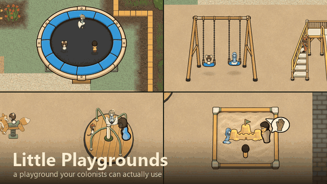

# Little Playgrounds

A RimWorld mod by choco for **RimWorld 1.6 and 1.7**. Requires **Biotech**.

Build a playground and watch your colonists use it. A child can start rocking on a seesaw alone, a friend can take the other seat, and a nearby adult can stop to watch. Children gain learning through play, while adults can visit for recreation.

[Subscribe on Steam Workshop](https://steamcommunity.com/sharedfiles/filedetails/?id=3828953545) · [Illustrated guide (English)](https://rucy74.github.io/Rimworld-Little-Playgrounds/) · [Browse the 0.1.7 source and mod files](https://github.com/rucy74/Rimworld-Little-Playgrounds/tree/v0.1.7)



## Build your first playground

1. Subscribe on Steam, then enable **Biotech** and **Little Playgrounds** in the Mods menu.
2. Open **Architect → Recreation** and place a swing, slide or seesaw. For a small indoor playroom, try the ball pit or the small slide.
3. Add a patch of sand or rubber from **Floors**. The playground fence, entrance and low edging are under **Structure**.
4. Select a ride and use **Visitors** to choose **Everyone** (the default), **Children only** or **Adults only**. On supported rides you can also choose a color palette or switch between the original and timber designs.

For a larger playground, try a zipline, a roundabout or a shared trampoline. Leave room for quieter activities too. Children can build a sandcastle together or play shop at the little playhouse.

## How often do colonists visit?

In the Little Playgrounds mod settings, **Playground learning preference** controls how likely children are to want playground time when they pick a new learning activity. At the default of **2**, playground play gets twice the selection weight of an activity such as floor drawing. How often you see children visit also depends on their schedule and whether they can use a ride.

**Adults play with children as Childcare** lets adults assigned to Childcare join a child on shared equipment or watch a solo ride. Turn it off if you want adults to join during their own recreation time only.

## Build from source

This repository contains the mod files distributed on Steam and the C# source for that version. Players who install through the Workshop already have the compiled mod.

To build on Windows, use the .NET 10 SDK and a local installation of the RimWorld version you want to target. The 1.6 build targets .NET Framework 4.7.2. Run the matching command from the repository root, replacing the example path with the folder containing your game executable.

```powershell
# RimWorld 1.7
dotnet build Source/LittlePlaygrounds.csproj -c Release -p:RimWorldVersion=1.7 "-p:GameRoot=D:\Games\RimWorld-1.7"

# RimWorld 1.6
dotnet build Source/LittlePlaygrounds.csproj -c Release -p:RimWorldVersion=1.6 "-p:GameRoot=D:\Games\RimWorld-1.6"
```

The resulting `LittlePlaygrounds.dll` goes into `1.7/Assemblies/` or `1.6/Assemblies/`. Audio credits are in [SoundCredits.txt](Licenses/SoundCredits.txt).

## 한국어 안내

아이들이 직접 그네를 타고, 친구와 시소를 타고, 모래성을 쌓는 놀이터 모드입니다. **RimWorld 1.6·1.7**에서 사용할 수 있고 **바이오테크 DLC**가 필요합니다. 창작마당에서 구독한 뒤 오락 탭에서 첫 놀이기구를 지어 보세요. 아이는 놀면서 학습 욕구를 채우고, 어른은 여가 시간이나 육아 중에 함께할 수 있습니다. 기구를 선택하면 아이만 이용하도록 정할 수도 있습니다.

## 작성 이력

- 2026-11-23 23:18 KST — Steam 0.1.7 기준 설치, 놀이 설정, 소스 빌드 안내를 추가했습니다.
- 2026-11-24 23:31 KST — 상단에 한국어 플레이·코드 안내서 링크를 추가했습니다.
- 2026-11-25 23:11 KST — GitHub Pages 안내서 29쪽을 영어로 게시하고 상단 링크에 언어를 표시했습니다.
- 2026-11-25 23:16 KST — 저장소와 영어 안내서의 첫 화면에 창작마당 GIF 표지를 적용했습니다.
